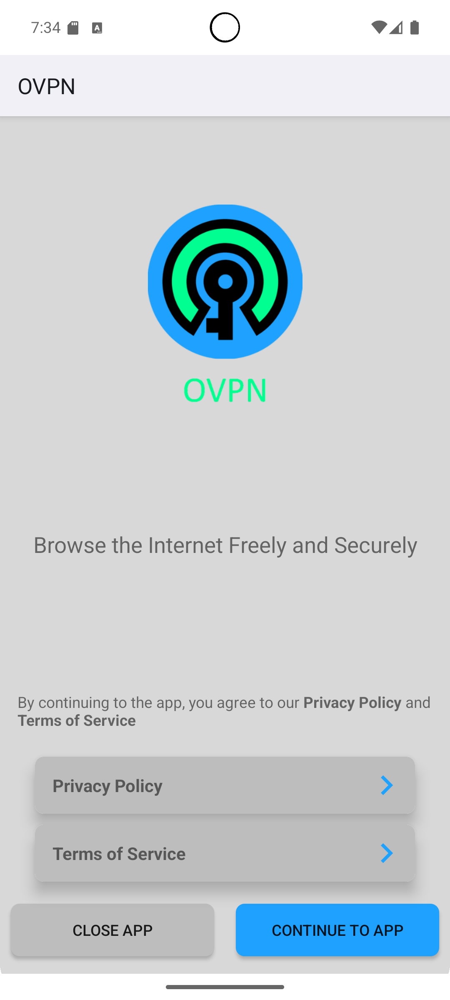

# 🔐 OpenVPN Android App

A modern, secure OpenVPN client for Android built with **Jetpack Compose** and **Material Design 3**.


---

## 📱 App Screenshots

### 🏠 Main Interface
<p align="center">
  
</p>

*Clean, intuitive main interface with easy connection controls*

### ⚙️ Server Selection
<p align="center">
  
</p>

*Browse and select from multiple VPN servers worldwide*

### 📊 Connection Status
<p align="center">
  
</p>

*Real-time connection status and network statistics*

---

## ✨ Features

### 🔒 **Security & Privacy**
- ✅ OpenVPN protocol support
- ✅ AES-256 encryption
- ✅ DNS leak protection  
- ✅ Kill switch functionality
- ✅ Certificate-based authentication

### 🌐 **Server Management**
- ✅ Multiple server locations
- ✅ Auto server selection
- ✅ Latency testing
- ✅ Server favorites
- ✅ Custom server import (.ovpn)

### 🎨 **Modern UI/UX**
- ✅ Material Design 3
- ✅ Jetpack Compose UI
- ✅ Dark/Light theme support
- ✅ Smooth animations
- ✅ Intuitive navigation

### 📊 **Advanced Features**
- ✅ Real-time connection statistics
- ✅ Connection logs
- ✅ Split tunneling
- ✅ Auto-reconnect
- ✅ Notification controls

---

## 🚀 Quick Start

### **For Users**

#### 📥 **Download & Install**
1. Download the latest APK from [Releases](../../releases)
2. Enable "Install from unknown sources" in Android settings
3. Install the APK
4. Open the app and connect!

#### 🔧 **First Time Setup**
1. **Import Server Config**: Add your `.ovpn` configuration file
2. **Enter Credentials**: Username/password if required
3. **Connect**: Tap the connect button
4. **Verify**: Check your IP address changed

### **For Developers**

#### 🛠️ **Development Setup**
```bash
# Clone repository
git clone https://github.com/vatsasiddhartha/Open_VPN1.git
cd Open_VPN1

# Quick setup
./setup.sh

# Configure API keys (see SETUP.md for details)
# Then build
./gradlew assembleDebug
```

📖 **Detailed Instructions**: See [SETUP.md](SETUP.md) for complete development setup guide.

---

## 📋 Requirements

### **For Users**
- 📱 Android 5.0 (API 21) or higher
- 🔓 Permission to install from unknown sources
- 📶 Internet connection

### **For Developers**
- 🔧 Android Studio Hedgehog (2023.1.1) or later
- ☕ JDK 11 or JDK 17
- 📱 Android SDK 21+
- 🐙 Git

---

## 🏗️ Architecture

### **Tech Stack**
- **Language**: Kotlin 100%
- **UI Framework**: Jetpack Compose
- **Architecture**: MVVM + Repository Pattern
- **DI**: Hilt/Dagger
- **Database**: Room
- **Networking**: Retrofit + OkHttp
- **VPN Core**: OpenVPN Library

### **Project Structure**
```
app/
├── src/main/java/com/dzboot/ovpn/
│   ├── activities/          # UI Activities
│   ├── fragments/           # UI Fragments  
│   ├── data/               # Data layer
│   ├── helpers/            # Utility classes
│   ├── constants/          # App constants
│   └── base/               # Base classes
├── templates/              # Configuration templates
└── .github/workflows/      # CI/CD workflows
```

---

## 🤝 Contributing

We welcome contributions! Here's how to get started:

### **🐛 Bug Reports**
1. Check existing [issues](../../issues)
2. Create detailed bug report with:
   - Device info
   - Android version  
   - Steps to reproduce
   - Screenshots if applicable

### **💡 Feature Requests**
1. Open an [issue](../../issues/new)
2. Describe the feature
3. Explain use case
4. Add mockups if possible

### **🔧 Code Contributions**
1. Fork the repository
2. Create feature branch: `git checkout -b feature/amazing-feature`
3. Follow coding standards
4. Add tests if applicable
5. Create Pull Request

---

## 🔄 Changelog

### **v1.0.0** (Latest)
- ✅ Initial release
- ✅ OpenVPN core integration
- ✅ Material Design 3 UI
- ✅ Server management
- ✅ Connection statistics
- ✅ Setup documentation added

---

## 📄 License

This project is licensed under the **MIT License** - see the [LICENSE](LICENSE) file for details.

---

## 🆘 Support

### **Need Help?**
- 📖 Read the [SETUP.md](SETUP.md) guide
- 🐛 Check [Issues](../../issues) for common problems
- 💬 Create new [issue](../../issues/new) for support

### **Contact**
- 📧 Email: [vatsasiddhartha3@gmail.com]
- 🐙 GitHub: [@vatsasiddhartha](https://github.com/vatsasiddhartha)

---

## ⭐ Show Your Support

If this project helped you, please consider:
- ⭐ **Starring** the repository
- 🍴 **Forking** for your own use  
- 🐛 **Reporting** bugs you find
- 💡 **Suggesting** new features
- 🤝 **Contributing** code improvements

---

## 📊 Project Stats


---

<p align="center">
  <b>🔐 Secure • 🚀 Fast • 🎨 Beautiful • 📱 Modern</b>
</p>

<p align="center">
  Made with ❤️ for the Android community
</p>
